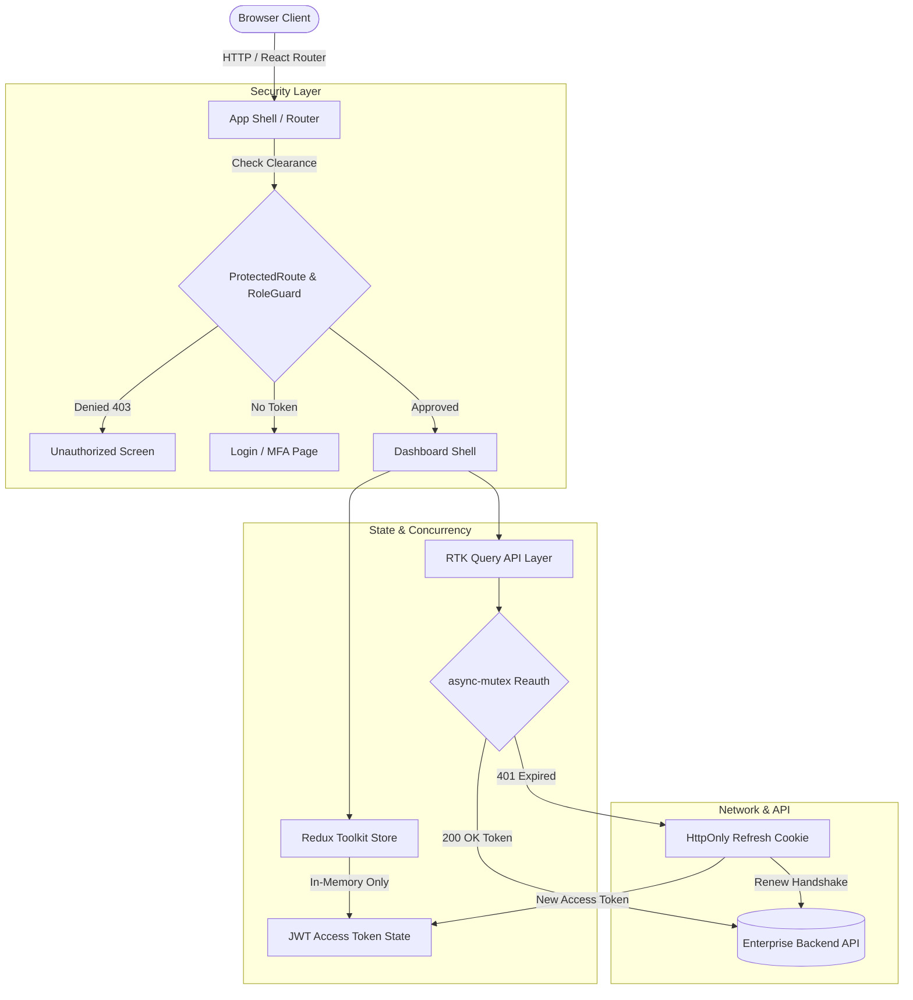

<div align="center">

# OFC360 Enterprise Web Frontend

<p align="center">
  
</p>

<p align="center">
  <strong>Production-grade workforce management, role-based governance, and AI-powered HR operations portal.</strong>
</p>

<p align="center">
  <a href="https://github.com/sharmavinit54538/ofc360/blob/main/LICENSE"></a>
  <a href="https://github.com/sharmavinit54538/ofc360/releases"></a>
  <a href="https://github.com/sharmavinit54538/ofc360/actions"></a>
  <a href="https://github.com/sharmavinit54538/ofc360/stargazers"></a>
  <a href="https://react.dev/"></a>
  <a href="https://www.typescriptlang.org/"></a>
  <a href="https://vitejs.dev/"></a>
  <a href="https://tailwindcss.com/"></a>
</p>

<p align="center">
  <a href="#demo">Live Demo</a> •
  <a href="#key-features">Key Features</a> •
  <a href="#getting-started">Getting Started</a> •
  <a href="#architecture">Architecture</a> •
  <a href="#contributing">Contributing</a>
</p>

</div>

---

## 📑 Table of Contents

- [About](#about)
- [Key Features](#key-features)
  - [Feature Matrix](#feature-matrix)
  - [1. Authentication & Security Subsystem](#1-authentication--security-subsystem)
  - [2. Multi-Tier Role-Based Dashboards (RBAC)](#2-multi-tier-role-based-dashboards-rbac)
  - [3. HR Operations & Administration](#3-hr-operations--administration)
  - [4. Recruitment & Talent Acquisition Hub](#4-recruitment--talent-acquisition-hub)
  - [5. Attendance, Shifts & Leave Management](#5-attendance-shifts--leave-management)
  - [6. AI Hub & Analytics](#6-ai-intelligence-hub--analytics)
- [Demo](#demo)
- [Tech Stack](#tech-stack)
- [Architecture](#architecture)
  - [Project Structure](#project-structure)
  - [Architecture Flow Diagram](#architecture-flow-diagram)
- [Getting Started](#getting-started)
  - [Prerequisites](#prerequisites)
  - [Installation](#installation)
  - [Environment Configuration](#environment-configuration)
  - [Development Server](#development-server)
  - [Building for Production](#building-for-production)
  - [Running Tests](#running-tests)
- [Usage](#usage)
  - [Client-Side Authentication Guarding](#client-side-authentication-guarding)
  - [Route Protection Matrix](#route-protection-matrix)
  - [Core API Routes](#core-api-routes)
- [Configuration](#configuration)
- [Roadmap](#roadmap)
- [Contributing](#contributing)
- [FAQ and Troubleshooting](#faq-and-troubleshooting)
- [License and Maintainers](#license-and-maintainers)

---

## ℹ️ About

Modern enterprises struggle with fragmented tools for HR operations, attendance tracking, recruitment pipelines, and role-based data security. **OFC360** solves this by unifying workforce administration, employee self-service, IT asset management, and AI intelligence into a single, high-performance web platform.

Engineered for **Super Admins, HR Executives, Team Managers, Employees, and IT Personnel**, OFC360 enforces zero-trust memory-only token storage, automated session recovery, and granular RBAC clearance matrices to ensure secure, streamlined corporate workflows.

---

## 🚀 Key Features

### Feature Matrix

| Feature | Category | Description | Primary Users |
|---|---|---|---|
| **Zero-Trust Auth & WebAuthn** | Security | In-memory JWT tokens, mutex-locked refresh queue, Passkeys | All Users |
| **Role Clearance Portals** | Governance | Dedicated dashboards tailored to 5 distinct organizational roles | SuperAdmin, HR, Manager, IT, Employee |
| **HR Operations Hub** | Operations | Asset tracking, visitor management, travel & expense workflows | HR Admins, IT Admins, Employees |
| **Talent Acquisition Suite** | Recruitment | End-to-end recruitment pipelines, scorecards, and candidate CRM | HR Admin, Hiring Managers |
| **Time, Shift & Rostering** | Workforce | Shift scheduling, rotational rosters, holiday calendars, timesheets | Managers, Employees, HR |
| **AI Hub** | Analytics | Meeting intelligence summaries, policy assistant, and HR chat bot | Executives, HR, Employees |

---

### 1. Authentication & Security Subsystem

#### What it does
Implements enterprise-grade authentication featuring memory-only access tokens, automatic cookie-based refresh handshakes, WebAuthn Passkeys (`@simplewebauthn/browser`), multi-factor authentication (MFA/OTP), and Zod schema validations.

#### Why it matters
Eliminates XSS token leakage vectors by never saving JWT access tokens to `localStorage` or `sessionStorage`. An `async-mutex` lock halts concurrent requests when a token expires, dispatches one single refresh request, and transparently retries stalled network calls.

#### How to use it
Authenticate through the unified login portal or register using email and WebAuthn credentials:

```typescript
import { useAuth } from '@/features/auth/hooks/useAuth';

export const UserProfileBadge = () => {
  const { user, isAuthenticated, logout } = useAuth();

  if (!isAuthenticated) return <span>Not logged in</span>;

  return (
    <div className="flex items-center gap-2">
      <span>{user?.fullName} ({user?.activeRole})</span>
      <button onClick={() => logout()} className="text-sm text-red-500">Sign Out</button>
    </div>
  );
};
```

#### Preview


---

### 2. Multi-Tier Role-Based Dashboards (RBAC)

#### What it does
Provides role-tailored dashboard landing pages based on verified clearance levels:
- `SUPER_ADMIN`: Organization lifecycle, global audit logs, system configurations.
- `HR_ADMIN`: Employee onboarding, headcount statistics, department planning.
- `MANAGER`: Team approvals, shift allocations, performance evaluations.
- `EMPLOYEE`: Self-service portal, personal timesheets, leave requests, expense claims.
- `IT_ADMIN`: Hardware inventory, security event monitoring, workstation provisioning.

#### Why it matters
Prevents privilege escalation and reduces UI cognitive load by rendering strictly what each persona is cleared to access.

#### How to use it
Navigation automatically redirects unauthenticated users to `/auth/login` and logged-in users to their role destination:

```tsx
<ProtectedRoute allowedRoles={['SUPER_ADMIN', 'HR_ADMIN']} requiredPermissions={['org:manage']}>
  <SuperAdminDashboard />
</ProtectedRoute>
```

#### Preview


---

### 3. HR Operations & Administration

#### What it does
Centralizes cross-functional office operations:
- **Asset Lifecycle**: Provision, assign, and audit IT hardware, laptops, and licenses.
- **Visitor Management**: Pre-register visitors, issue digital passes, track check-ins/check-outs.
- **Travel & Expense Claims**: Multi-currency receipts, travel itinerary submissions, manager approval workflows.
- **Onboarding & Offboarding**: Task checklists for day-one provisioning and structured exit handovers.

#### Why it matters
Replaces disparate spreadsheets with auditable, compliant HR workflows linked directly to employee profiles.

#### How to use it
Navigate to `/dashboard/hr-ops` or module sub-routes like `/dashboard/asset-management`, `/dashboard/expenses`, or `/dashboard/visitors`.

#### Preview


---

### 4. Recruitment & Talent Acquisition Hub

#### What it does
Full-cycle Applicant Tracking System (ATS) comprising job requisitions, candidate pipeline kanban, interview scheduling with calendar sync, candidate scorecards, offer letter management, and talent pool search.

#### Why it matters
Accelerates hiring velocity, tracks cost-per-hire and time-to-fill, and delivers a consistent interview rubric across departments.

#### How to use it
Access the recruitment dashboard at `/dashboard/recruitment` to manage job requisitions and candidate stages.

#### Preview


---

### 5. Attendance, Shifts & Leave Management

#### What it does
Complete time-tracking engine supporting shift rotations, roster calendars, statutory holiday schedules, timesheet submissions, and paid time off (PTO) balance calculations with approval routing.

#### Why it matters
Ensures accurate payroll feeds, enforces labor compliance, and gives employees immediate transparency into leave entitlements.

#### How to use it
Managers access `/dashboard/attendance/rosters` to plan weekly schedules; employees request leave at `/dashboard/leave`.

#### Preview


---

### 6. AI Hub & Analytics

#### What it does
Harnesses modern AI tooling to assist workforce operations:
- **Analytics Center**: Real-time workforce metrics, turnover predictors, and headcount trends.
- **AI Chat Assistant**: Context-aware natural language assistant for HR policies and benefits.
- **Meeting Intelligence**: Automated meeting summaries, action item extraction, and notes.

#### Why it matters
Dramatically cuts time spent answering repetitive HR queries and surfaces actionable talent insights to leadership.

#### How to use it
Access the AI hub at `/dashboard/ai-hub` or launch the interactive assistant via `/ai/chat-assistant`.

#### Preview


---

## 🖥️ Demo

Experience the live deployment and interactive prototypes:

- **Live Staging Application**: [https://ofc360.com](https://ofc360.com)
- **API Documentation**: [https://api.ofc360.com/api/v1/docs](https://api.ofc360.com/api/v1/docs)

<div align="center">
  
</div>

---

## 🛠️ Tech Stack

| Category | Technology | Version | Purpose in OFC360 |
|---|---|---|---|
| **Core Framework** | [React](https://react.dev/) | `^18.3.1` | Component-driven UI runtime |
| **Language** | [TypeScript](https://www.typescriptlang.org/) | `~5.6.2` | Type-safe enterprise code contracts and interfaces |
| **Bundler & Tooling** | [Vite](https://vitejs.dev/) | `^5.4.11` | Instant HMR development server and optimized rollup build |
| **State & Data** | [Redux Toolkit](https://redux-toolkit.js.org/) | `^2.3.0` | Global store, slice reducers, and caching |
| **Data Fetching** | [RTK Query](https://redux-toolkit.js.org/rtk-query/overview) | `^2.3.0` | Concurrent request caching, polling, and invalidation |
| **Concurrency Lock** | [async-mutex](https://github.com/DirtyHairy/async-mutex) | `^0.5.0` | Queues 401 token refreshes to prevent race conditions |
| **Biometric Auth** | [SimpleWebAuthn](https://simplewebauthn.dev/) | `^14.0.0` | WebAuthn and FIDO2 Passkeys authentication in the browser |
| **Styling** | [Tailwind CSS](https://tailwindcss.com/) | `^3.4.15` | Utility-first responsive styling and dark mode tokens |
| **Form Management** | [React Hook Form](https://react-hook-form.com/) | `^7.53.2` | High-performance uncontrolled form state tracking |
| **Validation** | [Zod](https://zod.dev/) | `^3.23.8` | Schema validation and runtime type assertion |
| **Routing** | [React Router DOM](https://reactrouter.com/) | `^6.28.0` | Client-side routing, nested layouts, and route guards |
| **Icons** | [Lucide React](https://lucide.dev/) | `^0.460.0` | Crisp, tree-shakeable SVG icon collection |
| **Test Runner** | [Vitest](https://vitest.dev/) | `^2.1.9` | Fast unit and integration testing runner |
| **DOM Testing** | [Testing Library](https://testing-library.com/) | `^16.3.3` | User-centric UI testing assertions |
| **Mocking** | [MSW](https://mswjs.io/) | `^2.15.0` | Mock Service Worker for offline integration tests |

---

## 🏛️ Architecture

### Project Structure

```text
ofc360/
├── public/                     # Static assets, brand icons, and favicons
├── src/
│   ├── app/                    # Application foundation & central wiring
│   │   ├── hooks.ts            # Typed useAppDispatch & useAppSelector hooks
│   │   ├── store.ts            # Redux store configuration & root reducer
│   │   ├── providers/          # StoreProvider, ThemeProvider, ToastProvider
│   │   └── router/             # AppRoutes declaration & RBAC route matrix
│   ├── features/               # Modular domain-driven feature boundaries
│   │   ├── ai-hub/             # AI insights, copilot & planning tools
│   │   ├── analytics/          # Executive reporting & workforce metrics
│   │   ├── assets/             # IT asset tracking & hardware assignment
│   │   ├── attendance/         # Shifts, rosters, holidays & timesheets
│   │   ├── auth/               # In-memory JWT, WebAuthn, guards, login & OTP
│   │   ├── chat-assistant/     # Contextual HR policy conversation bot
│   │   ├── dashboard/          # Dashboards per role (SuperAdmin, HR, IT, etc.)
│   │   ├── documents/          # Employee Documents policies
│   │   ├── employee-onboarding/# New hire checklists & setup procedures
│   │   ├── exit-management/    # Resignation, handovers & clearance offboarding
│   │   ├── expenses/           # Employee expense claims & receipts
│   │   ├── hr-ops/             # Central HR operational administration portal
│   │   ├── leave/              # PTO, sick leave balances & approvals
│   │   ├── meeting-intelligence# Audio/video transcription & action items
│   │   ├── performance/        # OKRs, KPIs, appraisals & reviews
│   │   ├── recruitment/        # Job requisitions, ATS pipeline & candidates
│   │   ├── settings/           # Organization profile, payroll rules & options
│   │   ├── timeline/           # Interactive career event timelines
│   │   ├── travel/             # Travel booking requests & approvals
│   │   ├── visitors/           # Building passes & visitor logbook
│   │   └── workforce/          # Employee directory & department organization
│   ├── shared/                 # Reusable enterprise building blocks
│   │   ├── api/                # baseQueryWithReauth with mutex concurrency
│   │   ├── layout/             # DashboardShell, AuthShell, Sidebars & Header
│   │   ├── lib/                # cn (clsx + twMerge), formatters, storage utils
│   │   ├── pages/              # 404 NotFound, 403 Unauthorized, ErrorBoundary
│   │   └── ui/                 # Design system atoms (Button, Input, Modal, Badge)
│   ├── index.html              # HTML5 template entry point
│   └── main.tsx                # React DOM root entry point
├── .env.example                # Environment variable configuration template
├── package.json                # Project dependencies and script declarations
├── tailwind.config.js          # Tailwind CSS theme extensions and colors
├── tsconfig.json               # TypeScript strict compiler configuration
└── vite.config.ts              # Vite bundling plugins and server port setup
```

### Architecture Flow Diagram



---

## 🏁 Getting Started

### Prerequisites

Ensure you have installed:
- **Node.js**: `v18.18.0` or higher (`v20.x` recommended)
- **npm**: `v9.x` or higher (or `pnpm` / `yarn`)
- **Git**: `v2.30+`

### Installation

1. **Clone the repository:**
   ```bash
   git clone https://github.com/sharmavinit54538/ofc360.git
   cd ofc360
   ```

2. **Install project dependencies:**
   ```bash
   npm install
   ```

### Environment Configuration

Copy the template file to create your local `.env`:

```bash
cp .env.example .env
```

Review the table below to configure the environment:

| Variable | Required | Default Value | Description |
|---|---|---|---|
| `VITE_APP_NAME` | **Yes** | `OFC360` | Brand application name rendered across pages |
| `VITE_APP_ENV` | **Yes** | `development` | Runtime environment (`development`, `staging`, `production`) |
| `VITE_APP_VERSION` | **Yes** | `1.0.0` | Client application version |
| `VITE_API_BASE_URL` | **Yes** | `https://api.ofc360.com/api/v1` | Base REST API endpoint for authentication and data |
| `VITE_ENABLE_MOCK_FALLBACK` | No | `false` | Enables client-side mock responses when backend is offline |
| `VITE_AUTH_COOKIE_DOMAIN` | No | `.ofc360.com` | Cookie domain for cross-subdomain refresh cookies |
| `VITE_AUTH_TOKEN_HEADER` | No | `Authorization` | Header name used to dispatch the Bearer token |

> [!CAUTION]
> Never commit `.env` or production credentials to Git. Keep credentials safe and configure secrets in your CI/CD provider.

### Development Server

Start the Vite development server with local network access on port `8080`:

```bash
npm run dev
```

The application will be accessible at:
- **Local:** `http://localhost:8080`
- **Network:** `http://<your-ip>:8080`

### Building for Production

Compile TypeScript and build the optimized production assets:

```bash
# Run strict type checking
npm run typecheck

# Build bundle into dist/
npm run build
```

To preview the production build locally:

```bash
npm run preview
```

### Running Tests

Execute unit tests and component assertions powered by Vitest:

```bash
# Run tests once
npm test

# Run tests in interactive watch mode
npm run test:watch
```

---

## 💡 Usage

### Client-Side Authentication Guarding

Secure any custom view using the declarative `<ProtectedRoute />`:

```tsx
import React from 'react';
import { ProtectedRoute } from '@/features/auth/components/ProtectedRoute';
import { AssetManagementPage } from '@/features/assets/pages/AssetManagementPage';

export const SafeAssetRoute: React.FC = () => {
  return (
    <ProtectedRoute
      allowedRoles={['SUPER_ADMIN', 'IT_ADMIN']}
      requiredPermissions={['it:assets']}
    >
      <AssetManagementPage />
    </ProtectedRoute>
  );
};
```

### Route Protection Matrix

<details>
<summary><strong>View Route Clearance Matrix</strong></summary>

| Route Pattern | Module | Clearance Tier | Required Permissions |
|---|---|---|---|
| `/dashboard/super-admin` | Core Admin | `SUPER_ADMIN` | `org:manage`, `users:read` |
| `/dashboard/hr-admin` | HR Dashboard | `SUPER_ADMIN`, `HR_ADMIN` | `hrms:payroll`, `hrms:leaves` |
| `/dashboard/manager` | Team Portal | `SUPER_ADMIN`, `HR_ADMIN`, `MANAGER` | `users:read` |
| `/dashboard/employee` | Self-Service | `ALL_AUTHENTICATED` | Self-Service |
| `/dashboard/it-admin` | Infrastructure | `SUPER_ADMIN`, `IT_ADMIN` | `it:assets`, `it:security_logs` |
| `/dashboard/hr-ops` | Operations | `SUPER_ADMIN`, `HR_ADMIN` | `hrms:attendance`, `hrms:leaves` |
| `/dashboard/attendance/*`| Time & Shifts | `SUPER_ADMIN`, `HR_ADMIN`, `MANAGER` | `hrms:attendance` |
| `/dashboard/recruitment` | ATS Hub | `SUPER_ADMIN`, `HR_ADMIN`, `MANAGER` | `users:read` |
| `/settings/*` | Configuration | `SUPER_ADMIN` | `it:system_config` |

</details>

### Core API Routes

The frontend communicates with the backend REST service across these primary endpoint groups:

| Method | Endpoint | Description | Sample Payload / Params |
|---|---|---|---|
| `POST` | `/api/v1/auth/login` | Password authentication | `{"email": "admin@ofc360.com", "password": "••••"}` |
| `POST` | `/api/v1/auth/refresh` | Token refresh handshake | _Handled automatically via httpOnly cookie_ |
| `POST` | `/api/v1/auth/webauthn/verify` | WebAuthn passkey assertion | `{"id": "...", "rawId": "...", "type": "public-key"}` |
| `GET` | `/api/v1/workforce/employees` | Paginated employee list | `?page=1&limit=20&dept=engineering` |
| `POST` | `/api/v1/attendance/clock-in` | Record employee time entry | `{"timestamp": "2026-10-23T09:00:00Z"}` |
| `POST` | `/api/v1/expenses/claims` | Submit new expense claim | `{"amount": 140.50, "category": "Travel", "receipt": "..."}` |

---

## ⚙️ Configuration

### Port and Host Configuration
Change the default dev port or network binding in `vite.config.ts`:

```typescript
export default defineConfig({
  server: {
    port: 8080,      // Modify dev port
    host: true,       // Listen on all network addresses
  },
});
```

### Tailwind Theme Customization
Brand colors, border radius, and fonts are configured in `tailwind.config.js`:

```javascript
/** @type {import('tailwindcss').Config} */
module.exports = {
  darkMode: 'class',
  theme: {
    extend: {
      colors: {
        brand: {
          50: '#f0f9ff',
          500: '#0284c7',
          900: '#0c4a6e',
        },
      },
    },
  },
};
```

---

## 🗺️ Roadmap

- [x] **Phase 1: Architecture & Foundation**
  - [x] Vite 5 + React 18 + TypeScript strict setup
  - [x] Redux Toolkit store with memory-only token storage
  - [x] Concurrency-safe `async-mutex` token refresh flow
- [x] **Phase 2: Authentication & RBAC**
  - [x] Multi-tier `ProtectedRoute` and `RoleGuard`
  - [x] WebAuthn biometric login support
  - [x] Dedicated dashboards (SuperAdmin, HRAdmin, Manager, Employee, ITAdmin)
- [x] **Phase 3: Core Operations**
  - [x] Shift and roster management with holiday calendars
  - [x] HR Ops portal (Assets, Visitors, Expenses, Travel, Exit)
  - [x] Recruitment Hub (ATS pipelines, candidates, scorecards)
  - [x] AI Intelligence Center and Chat Assistant
- [ ] **Phase 4: Optimization & Offline Capabilities**
  - [ ] Complete ESLint configuration and automated formatting
  - [ ] Expanded Vitest + React Testing Library component coverage
  - [ ] PWA offline support with background timesheet sync
  - [ ] Real-time WebSocket push notifications for approvals

---

## 🤝 Contributing

We welcome community contributions, bug reports, and suggestions!

1. **Fork the Repository:**
   Click the **Fork** button at the top right of [GitHub](https://github.com/sharmavinit54538/ofc360).

2. **Create a Feature Branch:**
   ```bash
   git checkout -b feat/your-feature-name
   ```

3. **Commit Your Changes:**
   Follow conventional commits formatting (`feat:`, `fix:`, `refactor:`, `test:`):
   ```bash
   git commit -m "feat(attendance): add roster export to csv"
   ```

4. **Verify Quality Gates:**
   Ensure all checks pass before submitting:
   ```bash
   npm run typecheck
   npm test
   ```

5. **Open a Pull Request:**
   Push your branch and open a PR against `main`:
   ```bash
   git push origin feat/your-feature-name
   ```

---

## ❓ FAQ and Troubleshooting

<details>
<summary><strong>1. Why is the access token lost on full page refresh?</strong></summary>

By design, access tokens reside **strictly in memory** (Redux store) to eliminate XSS token theft. On reload, the application automatically performs a silent refresh handshake using your secure `httpOnly` cookie at `/api/v1/auth/refresh`. Ensure your API server is reachable and `withCredentials: true` is allowed.
</details>

<details>
<summary><strong>2. Dev server fails with "Port 8080 is already in use"</strong></summary>

Another process is occupying port `8080`. You can terminate the running process or launch Vite with a fallback port:
```bash
# Specify alternative port
npm run dev -- --port 8081
```
</details>

<details>
<summary><strong>3. How do I enable mock data when developing without a backend?</strong></summary>

Set `VITE_ENABLE_MOCK_FALLBACK=true` in your `.env` file and restart the development server. The RTK Query layer will serve mock payloads for offline development.
</details>

<details>
<summary><strong>4. "Type error: Cannot find module '@/...'" during build</strong></summary>

Path aliases (`@/*`) are mapped to `src/*`. Ensure your IDE reads `tsconfig.json` and run:
```bash
npm run typecheck
```
</details>

<details>
<summary><strong>5. Cross-Origin Request Blocked (CORS) in development</strong></summary>

Ensure your backend server whitelist allows `http://localhost:8080` (or `http://127.0.0.1:8080`) with `Access-Control-Allow-Credentials: true`.
</details>

---

## 📄 License and Maintainers

### License
This project is licensed under the **MIT License** — see the [LICENSE](https://github.com/sharmavinit54538/ofc360/blob/main/LICENSE) file for details.

### Author & Contact
- **Project Lead**: Vinit Sharma ([@sharmavinit54538](https://github.com/sharmavinit54538))
- **Email / Inquiries**: [support@ofc360.com](mailto:support@ofc360.com)
- **Organization**: OFC360 Enterprise

### Acknowledgements
- Built with [React](https://react.dev/), [Vite](https://vitejs.dev/), and [Tailwind CSS](https://tailwindcss.com/).
- Icons provided by [Lucide](https://lucide.dev/).
- Passkeys enabled by [SimpleWebAuthn](https://simplewebauthn.dev/).

---

<div align="center">
  <sub>⭐ If you find OFC360 useful, please consider giving it a star on <a href="https://github.com/sharmavinit54538/ofc360">GitHub</a>!</sub>
</div>